# Claims Hub event flows

Producers and consumers of the Claims Hub Kafka topics on the Event Streaming Platform
(cluster `esp-prd`). Each arrow is labelled with the topic it carries.

```mermaid
flowchart LR
    claim_core_svc["claim-core-svc"]
    fnol_intake_svc["fnol-intake-svc"]
    triage_svc["triage-svc"]
    assessment_svc["assessment-svc"]
    reserve_engine["reserve-engine"]
    fraud_referral_svc["fraud-referral-svc"]
    settlement_svc["settlement-svc"]
    payment_orchestrator["payment-orchestrator"]
    recovery_svc["recovery-svc"]
    document_svc["document-svc"]
    notification_svc["notification-svc"]
    gl_posting_svc["gl-posting-svc"]
    reporting_feed_svc["reporting-feed-svc"]
    Claims_Data_Warehouse(["Claims Data Warehouse"])
    Corvane_Payments_Gateway_adapter(["Corvane Payments Gateway adapter"])
    Evidence_Intake_Gateway(["Evidence Intake Gateway"])
    MQ_to_Kafka_bridge__CLX_IF_049_(["MQ-to-Kafka bridge (CLX-IF-049)"])
    fnol_intake_svc -->|fnol.received.v1| triage_svc
    fnol_intake_svc -->|fnol.received.v1| claim_core_svc
    fnol_intake_svc -->|fnol.received.v1| notification_svc
    Evidence_Intake_Gateway -->|eig.evidence.received.v1| fnol_intake_svc
    Evidence_Intake_Gateway -->|eig.evidence.received.v1| document_svc
    Evidence_Intake_Gateway -->|eig.telematics.alert.v1| fnol_intake_svc
    claim_core_svc -->|claim.created.v1| Claims_Data_Warehouse
    claim_core_svc -->|claim.updated.v1| Claims_Data_Warehouse
    triage_svc -->|triage.completed.v1| reserve_engine
    triage_svc -->|triage.completed.v1| fraud_referral_svc
    triage_svc -->|triage.completed.v1| assessment_svc
    triage_svc -->|fraud.score.received.v1| fraud_referral_svc
    fraud_referral_svc -->|fraud.referral.created.v1| reporting_feed_svc
    fraud_referral_svc -->|fraud.referral.notice-due.v1| notification_svc
    notification_svc -->|notification.sent.v1| claim_core_svc
    MQ_to_Kafka_bridge__CLX_IF_049_ -->|claims.reserve.movement.v1| reserve_engine
    reserve_engine -->|reserve.changed.v2| gl_posting_svc
    reserve_engine -->|reserve.changed.v2| reporting_feed_svc
    assessment_svc -->|assessment.completed.v1| settlement_svc
    settlement_svc -->|settlement.agreed.v1| payment_orchestrator
    settlement_svc -->|settlement.agreed.v1| recovery_svc
    payment_orchestrator -->|payment.requested.v1| Corvane_Payments_Gateway_adapter
    Corvane_Payments_Gateway_adapter -->|payment.confirmed.v1| payment_orchestrator
    Corvane_Payments_Gateway_adapter -->|payment.confirmed.v1| gl_posting_svc
    recovery_svc -->|recovery.receipt.v1| gl_posting_svc
    document_svc -->|document.stored.v1| claim_core_svc
```

Notes:

- `claims.reserve.movement.v1` is published by the MQ-to-Kafka bridge CLX-IF-049 from the CLARA
  CLX-IF-042 extract (ADR-012).
- `reserve.changed.v2` replaced v1 when reserve-svc was renamed to reserve-engine (ADR-019).
