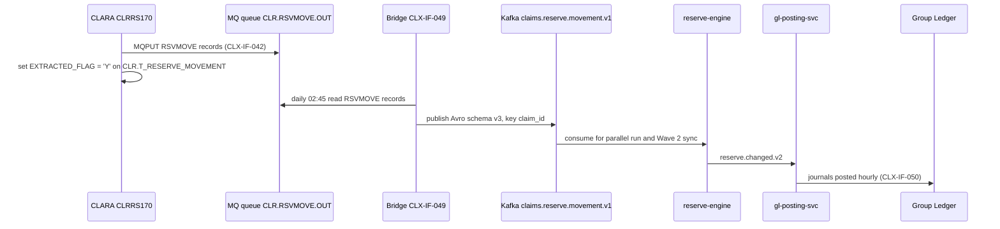

# Sequence diagrams

## Reserve movement synchronisation (CLARA to Claims Hub)



## Fraud referral and customer notice

```mermaid
sequenceDiagram
    participant TR as triage-svc
    participant SN as Sentinel
    participant FR as fraud-referral-svc
    participant SIU as SIU Case Manager
    participant NS as notification-svc
    participant NT as Notify
    TR->>SN: score claim over REST, timeout 800 ms (CLX-IF-036)
    SN-->>TR: Sentinel score
    TR->>FR: fraud.score.received.v1
    FR->>FR: refer if score >= 65; Tier-3 claims >= 60 from 2026-10-01
    FR->>SIU: create SIU referral (CLX-IF-041)
    FR->>NS: fraud.referral.notice-due.v1
    NS->>NS: due date = referral date + 10 business days
    NS->>NT: send notice FRN01 (letter) or FRN02 (SMS)
```
